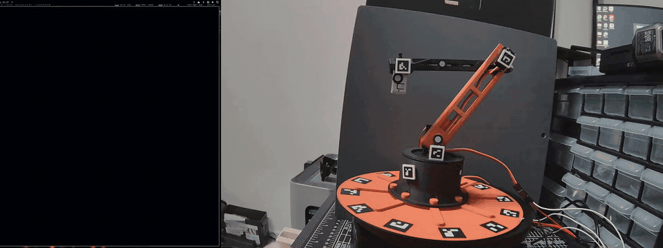

# robo-prober



*Real run, 8x speed: Discover, Identify (buzz each pin, name what moved), range of motion. [Full video](docs/demo.mp4).*

**To use:** `cd robo_prober`, then run `python robo_prober.py`

It checks what it needs, asks before installing anything (Y/n), or says it's good to go
and starts. Linux, Windows and macOS. (`python3` on systems without a `python` command.)

Find the robot controller on your USB bus, probe its servos only within limits
you've approved, find each servo's safe range of motion by hand, and export
what you learned as a validated hardware map or URDF.

[](https://github.com/evilhobo1911/robo_prober/actions/workflows/ci.yml)

## Hardware test status

| Passed on real hardware (ESP32-S3, 2026-10-22) | Physical test pending |
|---|---|
| Pin survey (driven / pulled / floating), no PCA9685 needed | ESP32, S2, C3, C6 (builds and simulator only) |
| Identify: pins in order, quick buzz, Y/N, naming, next pin buzzes automatically; boot pins left out | Raspberry Pi 4 / 5 / Zero 2 W and Jetson Orin agent (emulated GPIO only) |
| Range of motion (ROM 1 / ROM 2, relative sliders, narrow/widen) | Firmware backup and restore from the app |
| E-stop latch, disarm, map save | PCA9685 discovery, LED blink, button watch, I2C scan on hardware |
| Firmware check on Connect (background) and install from the app: 0.3.0 → 0.3.1 | "Set all servos to 0" |
| | Bench tab (step 3): drag servos on, group slider with Invert, buzz, Use as start |
| | Identify: "Moved one way only / spins" (key O) marks a servo faulty |
| | Identify: servo type (type-ahead or 20 questions) and its safe starting band |
| | Firmware 0.3.1: PCA9685 pins cached in NVS (no PCA9685 on the test arm) |

Everything in the right column is covered by automated tests but has not yet run on a physical board.

## Who it's for

Hobbyists, students and researchers who have a servo-driven robot (an arm, a
legged robot, a pan/tilt rig) on an ESP32 or similar board and want to work out
which channel moves which joint, and how far each one can safely go, without
guessing. If you'd rather not send random PWM to an unknown board and hope
nothing breaks, this tool does the work one small, approved, slow step at a time.

It runs on Linux, Windows and macOS, as a command-line tool, a small desktop
window, or a Python library other programs can import.

## Safety model

robo-prober is **fail-closed**. If something isn't explicitly allowed, it doesn't
happen.

- **Discovery is read-only.** `discover` lists serial ports without opening them.
- **A USB ID is only a hint.** A VID/PID usually identifies a USB-to-UART bridge
  chip, not the board behind it. You pick the exact board yourself.
- **Identification needs consent.** `identify` resets the chip (via `esptool`),
  so it only runs when you pass `--consent-controller-identification YES_RESET_ALLOWED`.
- **A pinout is not a permission.** The board catalog describes pins, and every
  pin record denies probing, reading, writing and PWM. The firmware only *reads*
  pins until you arm; then it drives one pin at a time, when you press Wiggle or
  Blink, never a pin the catalog reserves (flash, USB, the host serial link) and
  never a pin the survey finds driven by something else.
- **Arming is manual.** Nothing moves until you arm with a session token and
  confirm that a physical power cutoff is within reach.
- **The firmware enforces limits too.** Outputs are off at boot. Each channel
  has a pulse band (default a conservative 1400–1600 µs); anything outside it is
  refused by the controller itself, even if the host asks.
- **Everything moves slowly.** Moves are slew-limited on the host and again in
  the firmware, so a servo follows a target instead of jumping to it.
- **Silence stops everything.** While armed, the host sends a heartbeat. If the
  host crashes, hangs or is unplugged, the firmware watchdog releases every
  output within a second.
- **Stop is always available.** `DISARM`, `STOP` and a latching `ESTOP` (plus an
  optional hardware e-stop input) release every output. The window has an
  always-visible E-STOP button, and Esc does the same.
- **Any doubt stops the session.** A malformed reply, timeout or mismatched
  acknowledgement aborts the session and sends `STOP`. Bad input to the
  firmware is rejected and never moves anything. There are no "recovery" moves.
- **People decide, not heuristics.** Range of motion comes from where *you*
  stop the servo. A joint assignment only goes into the map once a person
  confirms it.

This is software. Keep a hand on the power cutoff the first time anything moves.

## Quickstart

### 1. Install

Clone or download the repository, then `python robo_prober.py`. On the first run it
asks before creating a private `.venv` next to itself and installing the libraries into
it (nothing system-wide); after that it says it's good to go and opens the
range-of-motion window. Any robo-prober command can follow it, e.g.
`python robo_prober.py doctor` or `python robo_prober.py run-demo --out demo-map.json`.
`-y` skips the question.

`ROBO_PROBER_EXTRAS=all` makes it also install the camera and
scan-to-URDF extras. With pip or pipx instead:

```bash
pipx install "git+https://github.com/evilhobo1911/robo_prober"
# or, with the optional extras (camera, scan-to-URDF, esptool):
pipx install "robo-prober[all] @ git+https://github.com/evilhobo1911/robo_prober"
```

From a clone:

```bash
python -m venv .venv && . .venv/bin/activate      # Windows: .venv\Scripts\activate
pip install -e ".[all,test]"
pytest
```

`robo-prober doctor` reports what your installation can do (Python, Tk, extras,
serial ports).

### 2. Try it with no hardware

Everything works against a built-in emulator of the firmware:

```bash
robo-prober run-demo --out demo-map.json        # probe session + map export
robo-prober validate-map demo-map.json
robo-prober rom-gui --emulator --map demo-map.json --operator you
```

### 3. Flash the firmware to an ESP32

You don't need PlatformIO: the window and `python robo_prober.py firmware install`
back up the board and install the prebuilt firmware for you (see
[Firmware: backup and install](#firmware-backup-and-install)). To build it yourself:
`firmware/esp32_robo_prober/` is a PlatformIO (and Arduino IDE) project for the
ESP32 family (ESP32, -S2, -S3, -C3, -C6). Servos can be on a PCA9685 board (found
at boot on whatever pins it's wired to) or straight on GPIO pins. Its
[README](firmware/esp32_robo_prober/README.md) covers wiring and options.

```bash
pip install platformio
cd firmware/esp32_robo_prober
pio run -e esp32-s3-devkitc-1 -t upload --upload-port /dev/ttyACM0   # Windows: COM3, macOS: /dev/cu.usbserial-...
```

Environments: `esp32dev`, `esp32-s2-saola-1`, `esp32-s3-devkitc-1`,
`esp32-c3-devkitm-1`, `esp32-c6-devkitc-1`.

### 4. Discover, identify, choose the board

```bash
robo-prober discover
robo-prober identify --port /dev/ttyUSB0 --consent-controller-identification YES_RESET_ALLOWED
robo-prober boards --chip ESP32
```

Port names: `COM3` on Windows, `/dev/cu.usbserial-…` or `/dev/cu.usbmodem…` on
macOS, `/dev/ttyUSB0` or `/dev/ttyACM0` on Linux.

### 5. Approve channels, then probe

Copy and edit the examples in [`examples/`](examples/). Every value in the
permission file should be a limit you've checked by hand on your hardware.

```bash
robo-prober validate-permissions examples/permissions.esp32-pca9685.json
robo-prober probe \
  --port /dev/ttyUSB0 --protocol ROBOPROBE/1 \
  --permissions examples/permissions.esp32-pca9685.json \
  --controller-identity examples/controller-identity.json \
  --confirmations examples/confirmations.json \
  --observations observation.json \
  --arm-token "$(date +%s)" --power-cutoff-confirmed \
  --out my-robot.map.json
```

Each approved channel starts output at its approved neutral, moves one step
and comes straight back. On v0.2 firmware the approved band is also handed to
the controller before arming, and each move waits until the slew-limited
output arrives.

`--observations` takes one or more marker observations: either recorded with
`robo-prober vision capture` + `vision export`, or written by hand in the same
format as [the bundled synthetic fixture](src/robo_prober/data/synthetic_observation.json).

### 6. Find each servo's range of motion

```bash
robo-prober rom-gui --port /dev/ttyUSB0 --map my-robot.map.json --operator you
```

See [Range of motion](#range-of-motion) below.

## Firmware: backup and install

robo-prober never relies on the firmware already on a board. On Connect (Discover or
Connect & arm) it says HELLO; if the board doesn't answer as the current robo-prober
firmware (version and capabilities), it asks once:

> This board isn't running robo-prober. Back up everything on it to
> ~/robo_prober_backups and install the robo-prober test firmware? Unplug servo power first.

**Back up and install** identifies the chip with esptool (type, MAC, flash size), reads
the **whole flash** to `~/robo_prober_backups/<chip>-<mac>-<date>.bin` plus a `.json`
(chip, MAC, size, sha256, date), writes the prebuilt image for that chip at 0x0,
verifies it, and checks HELLO again before continuing to Discover. A failed or
short backup stops before anything is written; backups are never overwritten.
Nothing is flashed without that click. **Restore original firmware** writes the
newest backup for that board's MAC back (or one you pick), only to the board with the
same MAC.

```bash
python robo_prober.py firmware backup  [--port P]
python robo_prober.py firmware install [--port P] [-y]
python robo_prober.py firmware restore [--port P] [--backup FILE] [-y]
```

Raspberry Pi and Jetson boards are never flashed; they run `python -m robo_prober.sbc`.
Maintainers rebuild the images in `src/robo_prober/firmware/` with
`python -m robo_prober.firmware_build` (needs PlatformIO).

## Find servos

`python robo_prober.py` opens the window on step 1. You don't need to know the
wiring.

1. **Discover** (nothing moves). The firmware reports its board profile and
   classifies every usable pin by reading it with the internal pull-up, then the
   pull-down: *floating* (nothing, or a servo or LED input), *pulled up/down* (a
   resistor: a button, an I2C line, an LED; proven with the ADC), or *driven* by
   something else (never driven by robo-prober). It shows the PCA9685 it found at
   boot ("PCA9685 at 0x40 on SDA 1 / SCL 2") and the I2C devices on pairs of
   pulled-up pins. Tick **Watch buttons** and press each button: the pins that
   change are listed.
2. **Identify** (after Connect & arm). One pin (or PCA9685 channel) at a time:
   "GPIO 4: it will go to 1500 µs, then wiggle ±150 µs slowly. Make sure it's
   clear." Press **Wiggle as servo** or **Blink** (LEDs, buzzers), then say what
   happened (**Servo moved**, **Moved one way only / spins**, **Light / sound**,
   **Nothing**, **Try again**; keys Y, O, L, N) and name it ("shoulder"). After
   Y you can give the **servo type** (optional): type-ahead over the servo
   database, or **Don't know? Identify it** for a 20-questions helper. Its
   conservative safe band (never wider than 1000-2000 µs) becomes that servo's
   starting band on the bench and in range of motion, and its id goes in the map.
   A servo that turns the same way for every pulse (broken feedback, or a
   continuous-rotation servo) is saved as **faulty** with a note: the bench and
   range of motion skip it and say why, and if it is still held on a PCA9685
   channel everything is disarmed. Floating pins come first, then pulled ones, then PCA9685
   channels, then boot-strapping pins (after a confirmation). Every GPIO is
   released after its probe. **Save hardware map**, then **Go to range of
   motion**.
3. **Bench**: drag identified servos onto the bench (or click them), **Power
   up** (one confirmation), then move them one by one or together with the
   group slider (**Invert** flips one), each inside its start ±300 µs (or its
   servo type's band). **Buzz**, **Use as start**, **Widen** / **Narrow**.
4. **Range of motion** shows only the named servos, labelled with their names,
   each starting where its wiggle (or the bench) left it.

A servo straight on GPIO N is channel `100+N` everywhere (map, API, protocol).
E-STOP and Esc work throughout.

## Range of motion

The ROM window has one row per servo channel (from the hardware map, or
channels 0–15 without one):

- **Nothing jumps on its own.** Hobby servos report no position, so the first
  pulse a channel gets moves the servo from wherever it is. robo-prober never
  picks that pulse for you: arming outputs nothing, and each channel shows
  *"Servo will move to X µs from an unknown position - make sure it's clear"*
  next to its **Start at** value until you press **Enable**. The start value is
  the channel's last saved position, else the middle of its saved range, else
  a suggestion (its approved neutral) that you check. When you disarm, hit
  E-STOP or close the window, each channel's last pulse is written into the
  map (`last_position`), so the next session starts exactly where this one
  stopped.
- **A slider.** Once enabled, drag it and the servo follows *slowly*: the host
  moves the target at most 200 µs per second and the firmware slew-limits
  again on top.
- **Set ROM 1 and Set ROM 2.** Slide one way until the joint reaches the end
  of its safe travel and press **Set ROM 1**; slide the other way and press
  **Set ROM 2**. The safe range is `[min(ROM 1, ROM 2), max(ROM 1, ROM 2)]`.
  Which end you mark first, which way the servo turns and how the horn is
  mounted do not matter. Nothing about the servo is assumed: everything is
  pulse width in µs.
- **A conservative start band.** Before both marks exist, a slider only covers
  ±300 µs around the channel's start pulse. **Widen range** adds 200 µs on each side, one explicit click at a
  time. The full 500–2500 µs is never the default.
- **Firmware clamping.** Once both marks exist the range is sent to the
  firmware as that channel's band, and the slider cannot leave it. The strip
  under each slider shows the start band (grey), the ROM range (green), both
  marks and the current position. **Clear** goes back to the start band.
- **E-STOP** (big red button, or Esc) releases every output and latches until
  you clear it. The window's own timer sends the heartbeat, so if the window
  freezes or the program dies, the firmware watchdog releases everything on
  its own within a second.
- **Window controls** for tiling desktops: minimise, fullscreen (F11) and
  exit (✕ or Ctrl+Q). Exiting always disarms first and asks before quitting
  while servos are powered. The channel list scrolls, so it stays usable in a
  small tiled window. Dark theme with a green accent.
- **Save ROM to map** stores the range on each joint as a `rom` block
  (`rom1_us`, `rom2_us`, `min_us`, `max_us`, who and when). The joint's approved
  permission band is not changed: the ROM is evidence for your next permission
  file, not an approval by itself.

For scripts and tests, `robo-prober rom` records a range measured some other
way, and with `--port` (or `--emulator`) also sends it to the controller as the
channel's band (no motion, no arming):

```bash
robo-prober rom --map my-robot.map.json --channel 2 --rom1 1720 --rom2 1290 --operator you
```

## Servo database

`robo_prober.servo_db` ships a reference table of 133 common hobby and robot
servos (`data/servos.json`), from SG90s and MG996Rs to Hitec, Savox, Feetech,
goBILDA, Hiwonder and Dynamixel. Each entry records torque and speed at their
voltages, the pulse range as the datasheet states it, spline, size, weight and
its sources. Unknown values are null, and `verified` marks the 96 entries whose
key numbers came from a manufacturer page. Clones sold under the same name vary
widely, so treat a spec as a hint. The table is reference data only and never
drives a pin.

```python
from robo_prober import servo_db
servo_db.search("hitec 645")[0]["id"]          # 'hitec-hs-645mg' (also "mg996", "sg 90")
servo_db.safe_pulse_range("hitec-hs-645mg")    # conservative ROM start band, 1000-2000 if unknown
servo_db.Identifier().next_question()          # 20-questions: size, wires, gears, label, torque...
```

## Python API

robo-prober is also a library. Nothing here moves a servo until you arm.

```python
import robo_prober as rp

print(rp.discover())                          # ports are listed, never opened

with rp.connect("COM3") as ctl:               # "/dev/ttyUSB0", or rp.connect(emulator=True)
    ctl.set_limits(0, 1300, 1700, neutral_us=1500)
    ctl.arm(power_cutoff_confirmed=True)      # a session token is generated for you
    ctl.start(0, 1500)                        # first output: an explicit pulse, never a default
    ctl.set_pulse(0, 1550)                    # slew-limited ramp; blocks until it arrives
    ctl.estop()                               # or ctl.disarm(); leaving the block disarms

hw = rp.load_map("my-robot.map.json")
hw = rp.set_rom(hw, channel=0, rom1_us=1720, rom2_us=1280, set_by="you")
hw = rp.set_last_positions(hw, {0: 1550})     # where the next session should start
rp.save_map(hw, "my-robot.map.json", overwrite=True)
print(rp.get_rom(hw, 0))
```

`rp.RomSession` and `rp.RomChannel` are the logic behind the ROM window, for
building your own front end. `rp.load_markers("markers.json")` reads a tag
manifest (see [Camera observations](#camera-observations-optional)).

## Example output

Discovery with an ESP32 dev board on a CP210x bridge:

```text
1. /dev/ttyUSB0 10c4:ea60 interface_recognized - Silicon Labs CP210x USB/UART bridge
   USB ID note: bridge/interface hint only; exact board must be selected manually.
```

`run-demo`:

```json
{
  "out": "demo-map.json",
  "reloaded_joints": ["base_yaw", "elbow", "shoulder"],
  "status": "demo_complete"
}
```

The exported map (abridged):

```json
{
  "schema_version": 1,
  "status": "software_verified_physical_unverified",
  "identities": {"board_profile_id": "esp32_devkitc_v4_wroom32", "controller": {"chip": "ESP32"}},
  "joints": {
    "base_yaw": {"channel": 0, "direction": "positive", "invert": false,
                 "neutral_us": 1500, "min_us": 1460, "max_us": 1540, "route": "pca9685_servo",
                 "rom": {"rom1_us": 1700, "rom2_us": 1300, "min_us": 1300, "max_us": 1700,
                         "method": "operator_slider", "set_by": "you", "set_at": "2026-10-22T12:00:00Z"}}
  },
  "permission_hash": "…sha256 of the approved permissions…",
  "observations": ["…marker motion + every transport event…"]
}
```

Exports are atomic (temp file, fsync, rename) and are validated again after
writing. `validate-map` checks the schema, the joint/channel uniqueness, any
`rom` blocks and the permission hash.

## Supported hardware and platforms

| Layer | Supported |
| --- | --- |
| Operating systems | Linux (any distribution), Windows 10/11, macOS. CI runs the tests on all three with Python 3.11 and 3.12. |
| Controller | Anything that speaks `ROBOPROBE/1` over serial. Reference firmware: ESP32, ESP32-S2, ESP32-S3, ESP32-C3, ESP32-C6 (all build). |
| Servo outputs | PCA9685-style 16-channel servo boards (channels 0–15) and servos straight on GPIO pins (channel 100+N, LEDC PWM), 500–2500 µs. |
| Verified on hardware | ESP32-S3, 2026-10-22: a 3-servo arm with servos straight on GPIO, no prior wiring info. Discover, Identify (buzz + Y/N + names), range of motion and map save passed. Other boards and features: see *Hardware test status* below. |
| Chip identification | ESP32, ESP32-S2, ESP32-S3, ESP32-C3, ESP32-C6 (via `esptool`). |
| Board catalog | ESP32 SoC references, ESP32-DevKitC V4, ESP32-S3-DevKitC-1, Raspberry Pi Pico / Pico W, Arduino Uno R3. The firmware's pin tables are generated from it (`python -m robo_prober.firmware_pins`). |
| USB bridges recognized | CP210x, CH340, CH343, FT232, Espressif native USB, Arduino Uno, Pico. |
| Cameras (optional) | ArUco markers via OpenCV. Linux lists V4L2 cameras without opening them; on Windows and macOS you pass a camera index. |

Platform notes:

- The built-in emulator runs behind a real pseudo terminal on Linux and macOS
  (exercising the serial stack) and in-process on Windows. The pseudo-terminal
  tests are skipped on Windows; everything else runs everywhere.
- The ROM window needs Tk. It ships with the python.org installers for Windows
  and macOS; on Linux install your distribution's `python3-tk` (robo_prober.py
  tells you the exact command).
- On Linux your user needs access to the serial device (often the `dialout`
  or `uucp` group).

## ROBOPROBE/1 protocol

Newline-terminated ASCII over serial (default 115200 baud). One reply line per
command. v0.2 adds commands and fields; everything from v0.1 keeps its meaning.

```text
HELLO                                       -> RP1 OK proto=ROBOPROBE/1 mode=<disarmed|armed|estop> id=<id>
                                               [fw=<ver> outputs=<...> i2c=<sda>,<scl>|none pca9685=<0x40,...|none>
                                                watchdog_ms=<n> caps=limit,status,hb,token,estop,start,survey,watch,i2c,probe,blink
                                                fault=<none|watchdog|stop|estop|driver>]
BOARD                                       -> RP1 OK board=<catalog profile id> chip=<model> pins=<usable pins>
SURVEY pin=<n>                              -> RP1 OK pin=<n> class=<floating|pulled_up|pulled_down|driven_high|driven_low|reserved> adc=<mV|->
WATCH state=<on|off>                        -> RP1 OK watch=<1|0>
EVENTS                                      -> RP1 OK events=<pin:level,...|none>
I2C_SCAN sda=<p> scl=<p>                    -> RP1 OK devices=<0x40,...|none> pca9685=<0x40,...|none>
PROBE pin=<n> mode=servo start_us=<us> token=<token>
                                            -> RP1 OK pin=<n> channel=<100+n>
BLINK pin=<n> count=<1-10> token=<token>    -> RP1 OK pin=<n> blinked=<count>
RELEASE pin=<n> token=<token>               -> RP1 OK pin=<n> released=1
ARM token=<token> cutoff=confirmed          -> RP1 OK armed=1
START channel=<c> pulse_us=<us> token=<token>
                                            -> RP1 OK channel=<c> started_us=<us>
LIMIT channel=<c> min_us=<a> neutral_us=<n> max_us=<b> [slew_us_s=<r>]
                                            -> RP1 OK channel=<c> min_us=<a> neutral_us=<n> max_us=<b> slew_us_s=<r>
MOVE channel=<0-15|100+n> target_us=<us> seq=<n> [token=<token>]
                                            -> RP1 OK seq=<n> channel=<c> target_us=<us>
HB token=<token>                            -> RP1 OK hb=1
STATUS channel=<c>                          -> RP1 OK channel=<c> active=<0|1> current_us=<us> target_us=<us>
                                               min_us=<a> neutral_us=<n> max_us=<b> slew_us_s=<r> armed=<0|1>
STOP                                        -> RP1 OK stopped=1
DISARM                                      -> RP1 OK armed=0
ESTOP                                       -> RP1 OK estop=1
ESTOP_CLEAR cutoff=confirmed                -> RP1 OK estop=0
(any error)                                 -> RP1 ERR reason=<reason>
```

- The host requires `MOVE` acknowledgements to echo `seq`, `channel` and
  `target_us` exactly, and `LIMIT` acknowledgements to echo every value.
  Anything else aborts the session.
- Tokens are 1–32 characters from `A-Z a-z 0-9 _ . -`. v0.2 firmware requires
  the token from `ARM` on every `MOVE` and `HB` (`token_required`, `bad_token`).
- `LIMIT` sets a channel's band (500–2500 µs, `min < max`, neutral inside) and
  slew limit (1–2000 µs/s, default 250). It needs no arming and never moves
  anything. A driven channel only accepts a band that contains its current
  position and target (`position_outside_limits`). The default band is
  1400/1500/1600 µs. Bands live in RAM: after a reset the default applies again,
  and the host sends its bands at the start of each session.
- Arming outputs nothing. A channel's PWM begins only with `START` at a pulse
  the host chose (inside the band); until then `MOVE` is refused
  (`not_started`). The firmware never picks a start pulse itself, and a new
  session starts every channel from nothing again. `MOVE` outside the band is
  refused (`out_of_limits`). (`neutral_us` is kept only as a reference value.)
- While armed, the firmware releases everything and disarms if no `MOVE` or
  `HB` arrives within `watchdog_ms` (`fault=watchdog`). The host sends `HB`
  every quarter of that from a background thread.
- `ESTOP` latches: `ARM` is refused (`estop_latched`) until `ESTOP_CLEAR`.
- Malformed lines, unknown commands or fields, duplicate fields, non-numeric
  values, lines over 160 characters and non-printable bytes are rejected with
  `RP1 ERR` and change nothing.
- The host reads `caps` and only uses `LIMIT`, `STATUS`, `HB`, `START`, tokens
  and `ESTOP` when they are advertised. Against v0.1 firmware (no `caps`), `probe`
  still works as before; `rom-gui` refuses to arm.
- `STATUS current_us` is the pulse being output after slew limiting, not a
  measured servo position. Hobby servos report nothing back.
- v0.3 discovery: `SURVEY`, `WATCH`/`EVENTS` and `I2C_SCAN` only read (the scan
  clocks the two pins open-drain at the weakest drive strength). `SURVEY` calls a
  pin *pulled* only when the ADC shows the opposing internal pull moving it by
  150 mV or more (a resistor); a pin that holds its level without that proof is
  *driven*, and `PROBE`/`BLINK` refuse it (`pin_driven`). They also refuse pins
  the board profile reserves or that are input-only (`pin_reserved`), pins the
  firmware uses or already drives (`pin_claimed`), and run out at the chip's LEDC
  channels (`no_pwm_slot`); they need `ARM` (`not_armed`). `PROBE` attaches 50 Hz
  servo PWM at the given start pulse inside the channel's band (`LIMIT channel=100+n`
  first to set it); the channel then takes `LIMIT`, `MOVE` and `STATUS`. `BLINK`
  replies at once and pulses at 2 Hz, then releases the pin. Driven GPIOs use the
  weakest drive strength. WATCH switches itself off after 5 s without `EVENTS`.

## Camera observations (optional)

With `pip install "robo-prober[vision]"`, the `vision` commands record bounded,
camera-only sessions (they never open a serial port), detect ArUco markers,
and export reference-relative marker motion in image space:

```bash
robo-prober vision cameras
robo-prober vision capture --device /dev/video0 --config examples/vision.json --out session --frames 30 --seconds 5
robo-prober vision replay session --out session-replay
robo-prober vision export session --out observation.json --before 0 --after -1
```

On Windows and macOS, pass a camera index (`--device 0`) instead of a
`/dev/video*` path. Units are pixels and image-plane degrees. There is no
metric calibration.

If your tags come with a `markers.json` tag manifest
(`{"dictionary": "DICT_4X4_100", "tag_size_mm": 30, "tags": {"base": {"id": 0}, ...}}`,
as written by tag generators such as aruco-tag-maker), a vision config can
name tags instead of IDs. Nothing else is required to be installed:

```json
{"markers_file": "markers.json", "reference_tag": "base",
 "markers": [{"tag": "base", "link": "base_link"}, {"tag": "forearm", "link": "forearm_link"}],
 "dictionary_confirmed": true, "pixel_threshold": 3.0, "angle_threshold_deg": 3.0, "calibration": null}
```

## Scan to URDF (optional)

With `pip install "robo-prober[geometry]"`, the `model` commands take an OBJ
scan of your robot, split it into candidate link regions you can correct with
planes, boxes, face lists and merges, and, once you confirm scale, link frames,
joint axes and limits, export a portable visual URDF that is reloaded and
checked with `yourdfpy`.

```bash
robo-prober model propose scan.obj --parts 4 --out proposal.json
robo-prober model segment --config proposal.json --out candidates
robo-prober model articulate --config my-confirmed-model.json --out urdf
```

No scan is bundled. `python examples/build_synthetic_articulation.py` builds a
synthetic two-link arm and runs the whole pipeline. See
[docs/scan-segmentation.md](docs/scan-segmentation.md) for the config format.

## Limitations

- Only one motion route exists (PCA9685-style servo channels). No GPIO, no
  stepper or smart-servo buses.
- robo-prober never decides a limit on its own. ROM marks are where an operator
  stopped the servo, and neutral positions still come from you.
- The very first pulse on a channel still moves the servo from an unknown
  position to the start pulse. Saved last positions keep that move small, but
  a servo that was pushed by hand or by gravity while unpowered will jump back.
- There is no position feedback: the firmware knows the pulse it outputs, not
  where the horn actually is. A stalled or overloaded servo looks the same as
  one that arrived.
- The v0.2 firmware is compiled for ESP32 and ESP32-S3 in CI and its protocol
  and safety core is tested on the desktop, but it has not yet been run
  against physical servos for this release. Bench-test it with the power
  cutoff in hand before trusting it.
- Camera observations are image-space only (no calibration, no world-frame pose).
- URDF export is visual and kinematic only: no inertia, collision or dynamics.
- A successful demo proves the software path, not that your hardware is safe to move.

## License

MIT. See [LICENSE](LICENSE).
